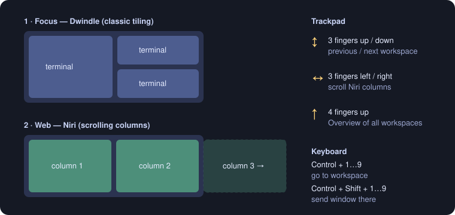

# macos-config

A reproducible, keyboard- and trackpad-driven macOS setup for Apple Silicon:
**[OmniWM](https://github.com/OmniNull/OmniWM)** tiling with Niri-style scrolling workspaces,
**Ghostty**, a **Nix (Lix) + Home Manager** shell, **Homebrew** apps, small **Hammerspoon** helpers and a
colour theme generated from your wallpaper. One guided script installs it; every step previews first,
backs up what it replaces and can be undone.



## What it sets up
| Area | Tool | Where |
|---|---|---|
| Windows, workspaces, gestures, Overview | OmniWM, built locally from upstream + [7 small patches](tools/omniwm/patches) | [`docs/omniwm.md`](docs/omniwm.md) |
| Terminal | Ghostty: translucent with blur, 13 pt, colours from the wallpaper | `home-manager/theme.nix` |
| Shell & CLI | zsh, Starship, Atuin (local history), ripgrep, fzf, zoxide, bat, jq, fd, gh, delta, ast-grep, yazi, lazygit, btop | `home-manager/` |
| Apps | Ghostty, Hammerspoon, Neru, Raycast, Stats | `homebrew/Brewfile` |
| Automation | Hammerspoon: contexts (Hyper+P), refocus after a switch, clean screen edges, Accessibility guard | `tools/hammerspoon/` |
| Keyboard navigation | Neru (hints, grid, scrolling) | `tools/neru/` |
| Theme | Stylix palette derived from the wallpaper, applied to the terminal, CLI tools, Neru, OmniWM and the macOS accent; re-applied when the wallpaper changes | `scripts/theme-*.sh` |
| macOS settings | Dock, Finder, key repeat, trackpad gestures handed to OmniWM | `scripts/macos-defaults.sh` |

## How the windows work
- **Workspace 1 (Focus)** tiles classically (Dwindle): each new window splits the space.
- **Workspaces 2–9** (Web, Messages, Atelier, …) are **Niri strips**: half-width columns that extend to the
  right instead of shrinking; you scroll through them.
- Apps land on their workspace by rule (Ghostty → Focus, Safari → Web, Discord → Messages, Finder → Atelier).
  Empty workspaces are skipped.
- **Trackpad**: 3 fingers up/down = previous/next workspace · 3 fingers left/right = scroll the columns ·
  4 fingers up = Overview of every workspace with live previews.
- **Keyboard**: Control+1…9 = go to a workspace, Control+Shift+1…9 = send the window there, Control+arrows =
  focus. Full map: [`docs/shortcuts.md`](docs/shortcuts.md) (written for a French AZERTY keyboard).
- No window ever touches a screen edge (8 pt gaps everywhere).

Everything about OmniWM (build, layouts, gestures, Overview, focus, rendering, settings):
[`docs/omniwm.md`](docs/omniwm.md).

## Requirements
- An Apple Silicon Mac on macOS 26 (tested on 26.6), with an admin account.
- [Xcode](https://apps.apple.com/app/xcode/id497799835) (to build OmniWM) and its command line tools
  (`xcode-select --install`).
- [Homebrew](https://brew.sh) and [Lix](https://lix.systems/install/) (a Nix implementation). Install them
  yourself from their official pages; the installer tells you when it needs them.
- About 15 GB of free space. Allow an hour, most of it downloads and the OmniWM build.

## Install
```sh
git clone https://github.com/YamadaBlog/macos-config.git ~/dev/macos-config   # any location works
cd ~/dev/macos-config
./install.sh          # plan: checks prerequisites and lists the steps; changes nothing
./install.sh --run    # runs the steps in order, asking before each one (y = run, s = skip, q = quit)
```
Each step is safe to re-run and can be run alone, e.g. `./install.sh --run omniwm`:

| Step | What it does | How to undo |
|---|---|---|
| `identity` | records your username, home and clone path (`home-manager/identity.nix`, `~/.config/macos-config/repo`) | `git checkout -- home-manager/identity.nix` |
| `backup` | copies your existing shell and app configs | copies are in `~/.local/state/macos-power-user-deploy/backups/install-*` |
| `homebrew` | installs the missing apps of the Brewfile (never removes or upgrades) | `brew uninstall --cask <app>` |
| `home-manager` | builds and activates the Nix configuration (CLI, shell, theme, login agents) | activate the previous generation ([recovery](docs/recovery.md)) |
| `macos` | applies the macOS settings | run the restore script it prints |
| `omniwm` | creates a local code-signing certificate, builds the patched OmniWM, installs it | previous app kept in the backups folder |
| `configs` | copies the OmniWM, Hammerspoon, Neru and Stats configs (each file backed up) and fits windows to your screen | backups printed by each copy |
| `permissions` | lists the permissions to grant and opens System Settings | System Settings |
| `doctor` | final diagnostic | — |

Home Manager will not overwrite an existing `~/.zshrc`: if it stops on that, move the file aside (it was
backed up) and re-run the step.

### Permissions (only you can grant them)
System Settings → Privacy & Security:
- **Accessibility**: OmniWM, Hammerspoon, Neru, Raycast — they move windows and handle hotkeys.
- **Screen Recording**: OmniWM — Overview and swipe previews.

Quit and reopen each app afterwards, then log out and back in once so the trackpad settings apply
everywhere. OmniWM is signed with a local certificate, so these grants survive rebuilds.

### Finish
`scripts/doctor.sh` must end with `no failure`; each problem it reports comes with the command that fixes
it. Raycast is the one app configured by hand: [`tools/raycast/README.md`](tools/raycast/README.md).

## Everyday commands
```sh
scripts/doctor.sh             # is everything installed and working?
scripts/verify.sh             # does the machine still match the repo?
scripts/capture.sh            # bring settings changed in the apps back into the repo (diff, then --accept)
scripts/apply.sh <id>         # push a repo config to the machine (preview, then --write)
scripts/macos-defaults.sh     # macOS settings: preview, then --write
tools/omniwm/build-local.sh   # rebuild OmniWM
scripts/emergency-stop.sh     # stop OmniWM, Neru and Hammerspoon if input gets stuck
```

## Customize
| To change | Edit | Apply |
|---|---|---|
| CLI tools, shell, prompt | `home-manager/home.nix`, `shell.nix` | `scripts/apply.sh home-manager --write` |
| Workspaces, layouts, gestures, hotkeys | `tools/omniwm/apply-registry.py` and `tools/omniwm/config/settings.toml` (keep them in agreement) | quit OmniWM, `python3 -I tools/omniwm/apply-registry.py ~/.config/omniwm/settings.toml --write` |
| macOS settings | the `WANTED` list in `scripts/macos-defaults.sh` | `scripts/macos-defaults.sh --write` |
| Terminal look | `home-manager/theme.nix` | `scripts/apply.sh home-manager --write` |
| Colours | change your wallpaper: the palette follows within seconds | automatic |
| Apps | `homebrew/Brewfile` | `scripts/apply.sh homebrew --write` |

## Update
- **Nix packages**: `(cd home-manager && nix flake update)`, then `scripts/apply.sh home-manager --write`.
- **Apps**: `brew upgrade --cask <app>`.
- **OmniWM**: put a newer upstream commit in `tools/omniwm/UPSTREAM`, check the patches still apply with
  `tools/omniwm/build-local.sh --check`, then run `tools/omniwm/build-local.sh`. Do not install OmniWM with
  Homebrew: it would replace the patched build.

## Troubleshooting
| Symptom | Fix |
|---|---|
| A shortcut or gesture does nothing | `scripts/doctor.sh`; check Accessibility for OmniWM |
| Mission Control opens behind the Overview | `scripts/macos-defaults.sh --write`, then log out and in |
| Grey previews in the Overview | grant Screen Recording to OmniWM, reopen it |
| Permissions lost after rebuilding OmniWM | build was not signed with the certificate: `tools/omniwm/create-signing-cert.sh`, then rebuild |
| Input frozen or windows stuck | `scripts/emergency-stop.sh`, then [`docs/recovery.md`](docs/recovery.md) |
| Something that used to be fixed is back | [`docs/bugs.md`](docs/bugs.md) lists every known bug, its cause and its check |

Known limitations: built and tested on one model (16" MacBook Pro, macOS 26.6); a clean install on a second
Mac has not been run yet. The shortcut registry assumes a French AZERTY keyboard.

## Repository layout
```
install.sh            guided installation
home-manager/         Nix flake: CLI, shell, theme, login agents
homebrew/Brewfile     apps
tools/omniwm/         pinned upstream, patches, build and signing scripts, settings + registry
tools/hammerspoon/    Lua helpers           tools/neru, tools/stats, tools/raycast   app configs
tools/configs.tsv     which live config file maps to which repo file
scripts/              doctor, verify, capture, apply, macos-defaults, theme, emergency, checks
docs/                 omniwm · shortcuts · architecture · macos · recovery · bugs
```
Contributing (humans and AI agents): [`AGENTS.md`](AGENTS.md) and [`CONTRIBUTING.md`](CONTRIBUTING.md).

## License
MIT (`LICENSE.txt`), except `tools/omniwm/patches/`, which modify OmniWM and are GPL-2.0-only like it.
